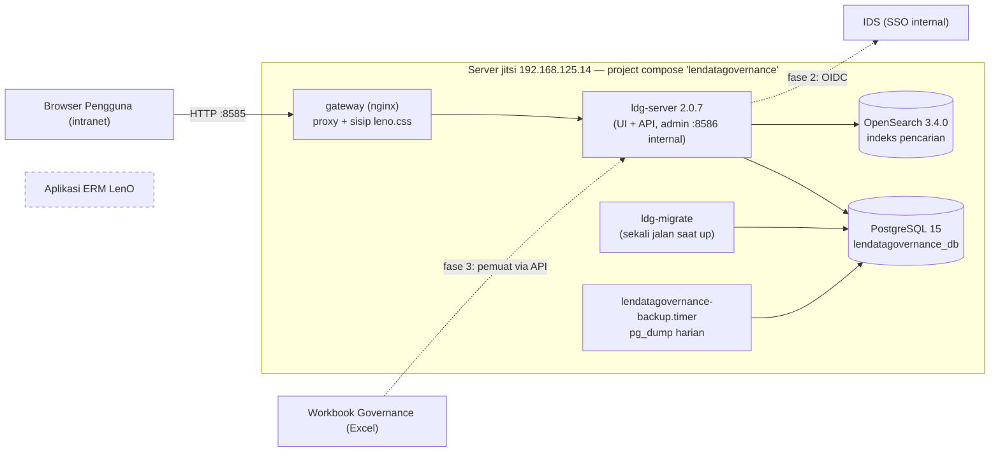

# Rencana Deployment Len Data Governance

> [!info] Ringkasan
> Alat tata kelola metadata ERM memakai **Len Data Governance** (server katalog open-source upstream 2.0.7, Apache-2.0) di server dev **jitsi (192.168.125.14)**. Komponennya PostgreSQL 15 dan OpenSearch 3.2.0, dijalankan dengan Docker Compose, dan diakses lewat **HTTP `http://192.168.125.14:8585`** di jaringan internal. Alat ini **tidak terhubung ke dan tidak mengubah Aplikasi ERM LenO**. Metadata dimuat dari Workbook Governance, setelah itu katalog Len Data Governance menjadi sumber utama metadata (data bisnis hanya di Trino lakehouse). Istilah mengikuti [[CONTEXT.md]].

---

## 0. Status & Pekerjaan Tertunda (per 2026-11-06)

| Fase | Status |
| :-- | :-- |
| 1 — Deploy | **Berjalan.** Server katalog 2.0.7 sehat, gateway :80/:8585, login basic auth, backup harian 01:30 aktif. |
| 3 — Workbook | **Dimuat 2026-11-04:** 18 tabel / 95 kolom, 58 istilah glosarium, 19 layar LenO, 29 lineage, 84 definisi test case, 68 team, policy `DG_UV_1`. 23 cacat dilaporkan. |
| 2 — IDS | **Tertunda** — menunggu client IDS dan DNS. Skrip `enable-ids.sh` siap (dengan preflight). |

| # | Pekerjaan tertunda | Pemilik | Status |
| :-- | :-- | :-- | :-- |
| P2-1 | Client IDS (confidential, redirect `http://dev-data.len.co.id/callback`) + konfirmasi redirect HTTP (V-4) | Tim IDS | Menunggu |
| P2-2 | A record `dev-data.len.co.id` → `192.168.125.14` (2026-11-06 masih NXDOMAIN) | Tim jaringan | Menunggu |
| P2-3 | Jalankan `enable-ids.sh`, uji login, nonaktifkan akun basic auth sementara | UV-3 | Setelah P2-1, P2-2 |
| P3-1 | Buat ulang token admin pemuat — token lama kedaluwarsa 2026-11-05 (HTTP 401). Pilih masa berlaku 60–90 hari | UV-3 | Terbuka |
| P3-2 | Perbaiki 23 cacat Workbook, lalu `reload-workbook.sh` | UG-1 / UV-1 | Terbuka |
| P3-3 | Impor keanggotaan team dari CSV HR/IDS (`email, ORG_ID`) | HR / tim IDS | Terbuka |
| P4-1 | Celah konteks: belum ada Domain, Data Product, Data Contract; test kualitas belum dijalankan (hanya definisi) | UV-1 | Terbuka |
| DOC-2 | Buku panduan per peran (PDF + PPTX) — `docs/manuals/` | UV-3 | Selesai 2026-11-06 |

---

## 1. Keputusan (hasil grilling 2026-11-03)

| Area | Keputusan |
| :-- | :-- |
| Alat | Len Data Governance, fitur bawaan katalog saja: beranda, Teams/Roles/Policies, kustomisasi logo/tema/teks, aset Tabel ERM. Tanpa aplikasi kustom. |
| Hubungan dengan LenO | Terpisah, database sendiri, **tanpa koneksi** ke database LenO. |
| Server | jitsi 192.168.125.14 (bersama, development). |
| Akses | HTTP `0.0.0.0:8585`, tanpa TLS, jaringan internal saja. Pintu masuknya nginx `gateway` (port 80 dan 8585): landing page, sisip tema Len, nama merek. |
| Login | Fase 1: basic auth sementara (admin UV-3). Fase 2: **IDS** (OIDC). Kunci identitas = email kantor. |
| Admin | UV-3 IT Development. |
| Teams | Direktorat › Divisi › Unit Kerja (45) dari `Master_Organization`; Seluruh Unit Kerja = root. Keanggotaan diimpor berkala dari daftar HR/IDS; satu Pengguna boleh di beberapa team. |
| Sumber metadata | Workbook Governance (Rev.0.1): yang valid dimuat, cacat dilaporkan. Setelah itu katalog Len Data Governance menjadi sumber utama metadata; data bisnis hanya di Trino lakehouse `lakekeeper.medallion_repository`. |
| Klasifikasi Sensitivitas | Per Elemen Data, terketat menang (F040 = Confidential); 4 level tersedia. |
| Peran tata kelola | Data Owner = Owner aset (team UG-1); Data Steward = Reviewer glosarium + properti; Data User = properti. |
| Matriks hak akses | Hak DG-* menjadi policy katalog yang berlaku; hak Layar LenO menjadi metadata referensi ([[docs/adr/0001-dg-permissions-enforced-leno-screen-rights-as-reference.md]]). |
| Layar LenO | Aset Dashboard di service "LenO ERM"; lineage kolom → layar. |
| Aturan kualitas | Definisi test case saja (tidak dijalankan). |
| Bahasa konten | Bahasa Indonesia sesuai Workbook. |
| Tampilan | **UIx: warna, huruf, gaya header/sidebar** ([[interface-menu.md]]). Disisipkan lewat CSS (`ui/leno-theme/leno.css`) oleh nginx `gateway`, ditambah pengaturan tema bawaan (warna, logo). Menu tetap milik aplikasi dasar. Susunan menu LPMS dan pola menu terkunci **tidak** dipakai. |
| Backup | `pg_dump` harian lokal, retensi 14 hari. |

---

## 2. Arsitektur



Aplikasi ERM LenO ditampilkan hanya sebagai konteks: **tidak ada panah ke LenO**.

| Service | Image | Network | Port host | Batas memori |
| :-- | :-- | :-- | :-- | :-- |
| postgresql | `postgres:15-bookworm` | ldg-internal | — | 1 GB |
| opensearch | `opensearchproject/opensearch:3.4.0` (heap 1 GB) | ldg-internal | — | 2 GB |
| ldg-migrate | `docker.getcollate.io/openmetadata/server:2.0.7` | ldg-internal | — | — (sekali jalan) |
| ldg-server | `docker.getcollate.io/openmetadata/server:2.0.7` (heap 1,5 GB) | ldg-internal, ldg-egress | — | 2,5 GB |
| gateway | `nginx:1.27-alpine` | ldg-egress | **0.0.0.0:80**, **0.0.0.0:8585** | 128 MB |

- **Total batas memori ≈ 5,6 GB.** Jitsi memiliki ≈ 10 GiB tersedia.
- **Subnet tetap:** `ldg-internal` 172.28.10.0/24 (tanpa rute keluar) dan `ldg-egress` 172.28.11.0/24. Keduanya tidak bertabrakan dengan network yang sudah ada (172.17–172.21, Podman 10.89.0.0/24, LAN 192.168.x).
- **Versi** mengikuti matriks resmi katalog upstream 2.0.x: OpenSearch ≥ 3.4.0 (3.2–3.3 punya bug Lucene 10 pada pencarian; dinaikkan 2026-11-10) dan PostgreSQL 15. Elasticsearch (ELv2/AGPL) dan MySQL (GPL) tidak dipakai.

---

## 3. Isi Folder `deploy/`

| Path | Fungsi |
| :-- | :-- |
| `compose.yaml` | 5 service, network bersubnet tetap, konfigurasi server (variabel sesuai `conf/openmetadata.yaml` 2.0.7) |
| `gateway/nginx.conf` | Proxy `gateway` → `ldg-server`; landing page `/`, menyisipkan `<link>` ke `leno.css`, nama merek "Len Data Governance" |
| `ui/leno-theme/leno.css` | Token warna LenO, font Poppins, gaya header merah & sidebar LPMS, tombol/kartu |
| `scripts/fetch-ui-assets.sh` | Mengambil font Poppins (OFL) dan logo LenO ke `ui/leno-theme/` |
| `.env.example` | Direktori, port, domain email, admin, image (dikunci digest) |
| `postgres/init/10-lendatagovernance.sh` | Membuat `lendatagovernance_user` + `lendatagovernance_db` (setara skrip resmi, tanpa Airflow) |
| `host/prepare.sh` | Aman untuk server bersama: cek port, `vm.max_map_count`, direktori, aturan UFW 8585, unit backup |
| `host/systemd/lendatagovernance-backup.{service,timer}` | Backup harian 01:30 |
| `scripts/secrets-init.sh` | Password DB, `FERNET_KEY`, `JWT_KEY_ID`, kunci RSA JWT milik sendiri |
| `scripts/pin-images.sh` | Mengunci image ke digest |
| `scripts/deploy.sh` | Guard digest → validasi → pull → up (migrasi otomatis) |
| `scripts/backup.sh` | `pg_dump -Fc`, retensi 14 hari |
| `scripts/verify.sh` | Pemeriksaan kesehatan, port, backup |

Artefak aplikasi kustom sebelumnya diarsipkan di `_plan/archive/deploy-custom-app/`.

---

## 4. Runbook Fase 1 — Deploy di jitsi

> [!important] Jangan jalankan skrip dari `_plan/archive/`
> Skrip lama `bootstrap.sh` akan memutus port aplikasi lain dan mengganti `data-root` Docker.

**0. Bila Anda sudah menjalankan langkah stack lama (`/opt/erm-gov`)**, hentikan dulu tanpa menghapus data:
```bash
cd /opt/erm-gov/deploy && sudo docker compose down
```
Penghapusan `/srv/erm-gov` dan `/opt/erm-gov` dilakukan terpisah setelah dipastikan tidak dibutuhkan.

**1. Di Windows (PowerShell): salin folder `deploy/` ke server**
```powershell
scp -r C:\Projects\data-management-apps\deploy ubuntu@192.168.125.14:/home/ubuntu/ldg-deploy
```

**2. Di server (PuTTY): tempatkan file**
```bash
bind 'set enable-bracketed-paste off'
sudo mkdir -p /opt/lendatagovernance
sudo mv /home/ubuntu/ldg-deploy /home/ubuntu/data-governance/deploy/lendatagovernance
cd /home/ubuntu/data-governance/deploy/lendatagovernance
sudo find . -type f -exec sed -i 's/\r$//' {} +
sudo chmod +x host/*.sh scripts/*.sh
sudo cp .env.example .env
sudo nano .env
```
Di `.env`, isi `AUTHORIZER_PRINCIPAL_DOMAIN` dengan domain email kantor.

**3. Persiapan host**
```bash
sudo ./host/prepare.sh
```

**4. Rahasia**
```bash
sudo ./scripts/secrets-init.sh
```
Simpan salinan `/home/ubuntu/data-governance/data/secrets` di tempat aman di luar server (brankas/password manager tim).

**5. Kunci image & deploy**
```bash
sudo ./scripts/fetch-ui-assets.sh
sudo ./scripts/pin-images.sh
sudo ./scripts/deploy.sh
sudo docker compose logs -f ldg-migrate ldg-server
```
Start pertama memakan waktu beberapa menit. Tekan Ctrl+C setelah log server menunjukkan aplikasi berjalan.

**6. Login pertama.** Buka `http://192.168.125.14:8585` dari PC di jaringan kantor:
1. Masuk dengan admin bawaan. Pada konfigurasi basic auth standar, akunnya `admin@<AUTHORIZER_PRINCIPAL_DOMAIN>` dengan password `admin` (verifikasi V-2).
2. **Segera ganti password admin.**
3. Buat akun basic auth untuk admin UV-3 dan beri peran Admin. Akun sementara ini dinonaktifkan di fase 2.
4. Terapkan tema UIx di pengaturan tema/tampilan Len Data Governance (verifikasi V-6), dengan nilai dari [[interface-menu.md]]:

   | Pengaturan | Nilai |
   | :-- | :-- |
   | Warna utama (primary) | `#ae2524` |
   | Info | `#155dfc` |
   | Success | `#008236` |
   | Warning | `#bb4d00` |
   | Error | `#e7000b` |
   | Logo / monogram / favicon | URL aset logo Len resmi |

   Pengaturan tema bawaan ini mewarnai komponen UI. Sidebar, tabel, tab, dan font Poppins gaya UIx berasal dari `leno.css` yang disisipkan `gateway`.
5. Buka beberapa halaman (beranda, Explore, Glossary, Settings) dan periksa header & sidebar. Bila ada yang tidak berubah, sesuaikan selector di `leno.css` (V-8), lalu `sudo docker compose restart gateway`.

**7. Backup & verifikasi**
```bash
sudo systemctl enable --now lendatagovernance-backup.timer
sudo systemctl start lendatagovernance-backup.service
sudo ./scripts/verify.sh
```

**Rollback** (tanpa menyentuh aplikasi lain):
```bash
cd /home/ubuntu/data-governance/deploy/lendatagovernance && sudo docker compose down
```
Data tetap di `/home/ubuntu/data-governance/data`.

---

## 5. Backup, Restore, Upgrade

**Restore** dari dump:
1. `sudo docker compose stop ldg-server`
2. ```bash
   sudo docker compose exec -T postgresql pg_restore -U postgres -d lendatagovernance_db --clean --if-exists < /home/ubuntu/data-governance/data/backup/lendatagovernance_db-<waktu>.dump
   ```
3. `sudo docker compose up -d`
4. Bangun ulang indeks pencarian dari UI: **Settings › Applications › Search Indexing › Run**.

Restore memerlukan `lendatagovernance.env` dan `jwt/` yang sama dari salinan rahasia.

**Upgrade versi** server katalog (image upstream):
1. Jalankan backup.
2. Ganti tag di `.env` (mis. `2.0.8`), lalu `pin-images.sh` → `deploy.sh`. Migrasi skema berjalan otomatis.
3. Periksa catatan rilis untuk perubahan versi OpenSearch/PostgreSQL yang didukung.
4. Periksa tampilan header & sidebar: UI katalog yang berubah bisa membuat selector di `leno.css` tidak berlaku lagi (V-8).

---

## 6. Fase 2 — Login via IDS (setelah client tersedia)

**Permintaan ke tim IDS:**

| Item | Nilai |
| :-- | :-- |
| Jenis client | Confidential, Authorization Code |
| Redirect URI | `http://dev-data.len.co.id/callback` (**HTTP**; pastikan IDS mengizinkan) |
| Post-logout redirect | `http://dev-data.len.co.id/` |
| Scope | `openid email profile` |
| Klaim wajib | `email` (kunci identitas), `name`, `preferred_username` |
| Yang diterima dari IDS | Discovery URL (`/.well-known/openid-configuration`), `client_id`, `client_secret` (lewat kanal aman), JWKS URL |

**Perubahan konfigurasi** (nama variabel dari `conf/openmetadata.yaml` 2.0.7; nilai provider dicek terhadap panduan SSO katalog upstream 2.0 saat fase 2):
- `AUTHENTICATION_PROVIDER` = provider OIDC kustom; `AUTHENTICATION_CLIENT_TYPE=confidential`.
- `AUTHENTICATION_AUTHORITY`, `AUTHENTICATION_CLIENT_ID`, `AUTHENTICATION_CALLBACK_URL`.
- `AUTHENTICATION_PUBLIC_KEYS` = JWKS Len Data Governance + JWKS IDS.
- `OIDC_CLIENT_ID`, `OIDC_DISCOVERY_URI`, `OIDC_CALLBACK`, `OIDC_SERVER_URL`, `OIDC_SCOPE`.
- `OIDC_CLIENT_SECRET` diletakkan di `lendatagovernance.env`, bukan di `compose.yaml`.
- `AUTHORIZER_ADMIN_PRINCIPALS` = nama pengguna email admin UV-3; `AUTHENTICATION_ENABLE_SELF_SIGNUP=true` agar Pengguna dibuat saat login pertama.

Setelah beralih, akun basic auth sementara dinonaktifkan.

---

## 7. Fase 3 — Memuat Workbook Governance

Pemuat adalah skrip Python (stdlib, `loader/catalog_loader.py`) yang memanggil API Len Data Governance. Skrip dijalankan dari container sekali jalan, tanpa Airflow, dan **idempoten**: menjalankannya ulang tidak menggandakan aset.

| Sumber (sheet) | Jadi apa di Len Data Governance |
| :-- | :-- |
| `Master_Organization` | Teams: Direktorat (BusinessUnit) › Divisi (Division) › Unit Kerja (Department); root = Seluruh Unit Kerja |
| `Database_Object`, `Data_Element_Attribute` | Database service "LenO ERM" (tanpa koneksi) › 18 Tabel ERM › kolom + tipe data |
| `Business_Glossary` | Glosarium "ERM", satu istilah per Elemen Data, ditautkan ke setiap kolomnya |
| Klasifikasi (dari `Data_Security_Access`) | Classification "Sensitivitas": Public, Restricted, Confidential, Strictly Confidential. Tag per kolom = level terketat Elemen Data-nya |
| `Data_Governance_Assignment` | Owner tabel = team UG-1; Steward = Reviewer istilah glosarium + properti kolom; Data User = properti kolom |
| `Data_Flow_Lineage` | Dashboard service "LenO ERM" › satu Dashboard per Layar LenO; lineage kolom → layar |
| `Data_Quality_Rules` | Definisi test case per kolom (tidak dijalankan) |
| `Data_Security_Access` | DG-* → Role & Policy untuk team pemegangnya (UV-1). Hak Layar LenO → properti "Hak Akses LenO" di aset Dashboard (tabel Unit Kerja × izin) |
| Cacat Workbook | Laporan cacat (F001–F005 "Not Found", kolom kembar, glosarium kosong, aturan tanpa acuan, konflik klasifikasi) untuk UG-1/UV-1 |

Keanggotaan team diimpor berkala dari CSV HR/IDS (`email, ORG_ID`).

---

## 8. Ketergantungan Eksternal

| Dari | Kebutuhan | Untuk |
| :-- | :-- | :-- |
| Tim IDS | Client OIDC (tabel §6), termasuk izin redirect HTTP | Fase 2 |
| HR / tim IDS | Daftar Pengguna ↔ Unit Kerja berbasis email | Keanggotaan team |
| UG-1 / UV-1 | Tindak lanjut laporan cacat Workbook | Fase 3 |
| UV-3 | Daftar email admin | Fase 1–2 |
| Tim jaringan | A record internal `dev-data.len.co.id` → `192.168.125.14` (per 2026-11-05 masih NXDOMAIN) | Fase 2 — redirect IDS menuju nama ini |

---

## 9. Risiko & Asumsi yang Wajib Diverifikasi

| # | Butir | Dampak bila salah | Tindakan |
| :-- | :-- | :-- | :-- |
| V-1 | Tag `opensearchproject/opensearch:3.4.0` (Docker Hub; bila CDN-nya terblokir, tarik dari `public.ecr.aws/opensearchproject/opensearch:3.4.0` lalu `docker tag`), `postgres:15-bookworm`, `openmetadata/server:2.0.7` tersedia | `pin-images.sh` gagal | Pakai patch terdekat yang tersedia dalam versi matriks |
| V-2 | Kredensial admin bawaan basic auth = `admin@<domain>` / `admin` | Tidak bisa login pertama | Cek log server / dokumentasi basic auth 2.0 |
| V-3 | `PIPELINE_SERVICE_CLIENT_ENABLED=false` tanpa efek samping selain menu ingestion | Peringatan di UI | Abaikan; ingestion memang tidak dipakai |
| V-4 | IDS mengizinkan redirect URI HTTP | Fase 2 terhambat | Tambahkan TLS self-signed di depan gateway |
| V-5 | Nilai provider OIDC kustom untuk 2.0 | Login IDS gagal | **Terverifikasi 2026-11-05**: semua variabel di `enable-ids.sh` ada di `conf/openmetadata.yaml` 2.0.7; IDS mendukung `code`, `client_secret_post`, RS256 |
| V-6 | Lokasi & isi pengaturan tema di katalog 2.0 (logo, monogram, favicon, 5 warna) | Tema LenO tidak bisa diterapkan penuh | Pakai yang tersedia; catat selisihnya |
| V-7 | Alamat IDS terjangkau dari jitsi (keluar dari network `ldg-egress`) | Login IDS gagal walau client sudah ada | **Terverifikasi 2026-11-05**: discovery & JWKS `ids.len.co.id` HTTP 200 dari network `ldg-egress`; sertifikat (DigiCert, s.d. 2027-03-20) dipercaya Java di container server |
| V-8 | Selector header/sidebar di `leno.css` (`.navbar-container`, `.left-sidebar-col`, kelas Ant Design) cocok dengan DOM UI 2.0.7 | Header/sidebar tidak berubah atau teks sulit dibaca | Periksa DOM halaman OM yang berjalan, sesuaikan selector; ulangi setiap upgrade OM |

**Risiko yang diterima untuk server dev:**
- Password basic auth melintas tanpa TLS di LAN.
- Port 8585 dipublish Docker sehingga tidak difilter UFW; terjangkau dari seluruh jaringan internal.
- OpenSearch tanpa plugin keamanan, tetapi hanya di network internal Docker.
- Server dipakai bersama aplikasi lain, sehingga kinerja bisa terpengaruh.

Semua risiko ini harus ditutup sebelum dipakai untuk produksi.

---

## 10. Sumber
- Katalog upstream, rilis terbaru `2.0.7-release`: https://github.com/open-metadata/OpenMetadata/releases/latest
- Katalog upstream, `docker-compose-postgres.yml` dan `conf/openmetadata.yaml` (tag 2.0.7-release): https://github.com/open-metadata/OpenMetadata/tree/2.0.7-release
- Katalog upstream 2.0.x, matriks versi (OpenSearch 3.2.0, Postgres 15): https://docs.open-metadata.org/v2.0.x/deployment/upgrade/docker.md
- Katalog upstream 2.0.x, kebutuhan produksi: https://docs.open-metadata.org/v2.0.x/deployment/production-ready-requirements
- Katalog upstream 2.0.x, deployment Docker: https://docs.open-metadata.org/v2.0.x/deployment/docker
